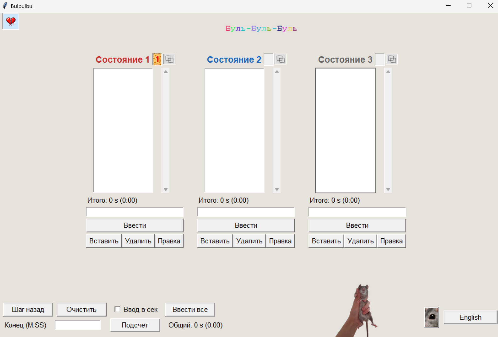

# Bulbulbul

[README на русском](README.md)

Created by София Лозовая (Sofia Lozovaya). [MIT License](LICENSE).

Bulbulbul is a desktop tool for annotating observations of animal interactions. It uses manually entered transition timestamps to calculate time spent in three mutually exclusive states. Define the states for your study and record the transitions as you review your observations.

## Interface



## Run

Download the archive for your platform from [Releases](https://github.com/Jenevi/bulbulbul/releases) and extract the entire folder. The bundles include the Python runtime.

- **Windows x86-64** — extract `bulbulbul-windows-x86_64.zip` and open `bulbulbul.exe` inside the `bulbulbul` folder.
- **Ubuntu 24.04 x86-64 / WSL2 with WSLg** — extract `bulbulbul-linux-x86_64.tar.gz` and run:

```sh
tar -xzf bulbulbul-linux-x86_64.tar.gz
./bulbulbul/bulbulbul
```

Running from source requires Python 3.11 or 3.12 with Tk and a graphical session. On Ubuntu or WSLg, run these commands from the repository directory:

```sh
sudo apt install python3-venv python3-tk
python3 -m venv .venv
.venv/bin/python -m pip install -r requirements.txt
.venv/bin/python main.py
```

On Windows with Python 3.11 and Tk, run these commands in PowerShell:

```powershell
py -3.11 -m venv .venv
.\.venv\Scripts\python.exe -m pip install -r requirements.txt
.\.venv\Scripts\python.exe main.py
```

## Use

1. Click **English** to switch the interface language. The columns from left to right are `A`, `P`, and `I`. Double-click a title to rename a state. Click the button next to a title to select the state at time zero.
2. Enter each timestamp in the column for the **new** state and click **Enter** or press Enter. In the default `M.SS` format, `1.23` means 1 minute 23 seconds and `123` is shorthand for the same time. Select **Input in seconds** to type whole seconds. The lists still display timestamps as `M.SS`.
3. For batch entry, copy lines such as `P: 0.10 0.25` and click **Enter all**. The prefixes `A:`, `P:`, and `I:` select a column. Unprefixed lines go into the current column.
4. Enter the **End time** using the current input format and click **Calculate**. If you leave the field blank, the calculation ends at the last timestamp. When timestamps tie, entry order determines which state takes effect last.
5. Use the buttons under each column to insert, delete, or edit timestamps. Ctrl+Z undoes a list change and Ctrl+F opens search. Save results using the icon in the top-left corner.

### Example

Copy the entire [synthetic example](examples/timestamps.txt) and use **Enter all** in `M.SS` mode. Set `A` as the initial state, enter an end time of `0.40`, and click **Calculate**. Expected durations are 20 s for `A`, 15 s for `P`, and 5 s for `I`, for a 40 s total.

## Output and limitations

- UTF-8 TXT includes the initial state, the entered end time, three timestamp lists, and duration totals. XLSX stores the same information in a `Results` sheet. Use a `.txt` or `.xlsx` extension when saving.
- The export adds `0.00` to the initial-state column. Timestamps are stored as text in `M.SS` format. Durations are recorded in seconds and as `M:SS`. The export is a report for review and analysis. Use the prefixed clipboard format shown above to enter timestamps again.
- The model supports three mutually exclusive states with whole-second resolution. Video playback, automatic behavior detection, and bout counts are outside the application's scope.
- The bundles target x86-64. Linux requires a graphical session, and WSL2 requires WSLg. ARM and macOS bundles are unavailable.

## Build

In the virtual environment on Ubuntu 24.04:

```sh
.venv/bin/python -m pip install -r requirements-build.txt
.venv/bin/python -m PyInstaller --noconfirm --clean --onedir --name bulbulbul --hidden-import PIL._tkinter_finder --add-data assets:assets main.py
./dist/bulbulbul/bulbulbul
```

Keep the complete `dist/bulbulbul` directory together when moving the bundle. This build produces an x86-64 Linux ELF executable.

To build on Windows, use Python 3.11 with Tk and PowerShell:

```powershell
.\.venv\Scripts\python.exe -m pip install -r requirements-build.txt
.\.venv\Scripts\python.exe -m PyInstaller --noconfirm --clean --onedir --windowed --name bulbulbul --hidden-import PIL._tkinter_finder --add-data assets:assets main.py
.\dist\bulbulbul\bulbulbul.exe
```
