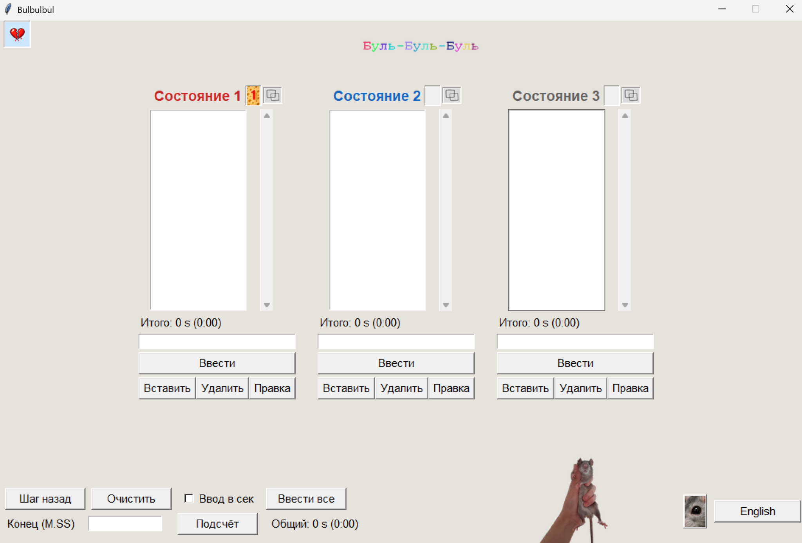

# Bulbulbul (Буль-Буль-Буль)

[English README](README.en.md)

Автор — София Лозовая. Лицензия [MIT](LICENSE).

Bulbulbul — настольная программа для разметки наблюдений за взаимодействием животных. Она суммирует время в трёх взаимоисключающих состояниях по вручную введённым отметкам переходов. Вы сами определяете смысл состояний и отмечаете моменты перехода при просмотре записи.

## Интерфейс



## Запуск

Готовые архивы доступны в разделе [Releases](https://github.com/Jenevi/bulbulbul/releases). Распакуйте архив целиком и запустите приложение. Установка Python для готовых сборок не требуется.

- **Windows x86-64** — распакуйте `bulbulbul-windows-x86_64.zip` и откройте `bulbulbul.exe` внутри папки `bulbulbul`.
- **Ubuntu 24.04 x86-64 / WSL2 с WSLg** — распакуйте `bulbulbul-linux-x86_64.tar.gz` и запустите:

```sh
tar -xzf bulbulbul-linux-x86_64.tar.gz
./bulbulbul/bulbulbul
```

Для запуска из исходников нужен Python 3.11 или 3.12 с Tk и графическая сессия. Команды для Ubuntu и WSLg из каталога репозитория:

```sh
sudo apt install python3-venv python3-tk
python3 -m venv .venv
.venv/bin/python -m pip install -r requirements.txt
.venv/bin/python main.py
```

На Windows с Python 3.11 и Tk можно запустить программу из исходников через PowerShell:

```powershell
py -3.11 -m venv .venv
.\.venv\Scripts\python.exe -m pip install -r requirements.txt
.\.venv\Scripts\python.exe main.py
```

## Использование

1. Определите три состояния. Колонки слева направо соответствуют `A`, `P`, `I`. Двойной щелчок по заголовку позволяет переименовать колонку. Кнопка рядом с заголовком выбирает состояние в момент 0.
2. Вводите отметки в колонку **нового** состояния и нажимайте **Ввести** или Enter. В стандартном формате `M.SS` отметка `1.23` означает 1 мин 23 с, а `123` — её сокращённую запись. Флажок **Ввод в сек** переключает формат ввода на целые секунды. Списки сохраняют отображение в `M.SS`.
3. Для пакетного ввода скопируйте строки вида `P: 0.10 0.25` и нажмите **Ввести все**. Префиксы `A:`, `P:`, `I:` выбирают колонку. Строки без префикса идут в текущую колонку.
4. Заполните поле **Конец** в выбранном формате и нажмите **Подсчёт**. Если оставить поле пустым, подсчёт завершится на последней отметке. При равных отметках порядок ввода определяет последнее состояние.
5. Кнопки под колонками позволяют вставлять, удалять и править отметки. Ctrl+Z отменяет правку списка, Ctrl+F открывает поиск. Значок в верхнем левом углу сохраняет результаты.

### Пример

Скопируйте весь [синтетический пример](examples/timestamps.txt) и вставьте его через **Ввести все** в режиме `M.SS`. Выберите начальное состояние `A`, укажите конец `0.40` и нажмите **Подсчёт**. Ожидаемые длительности: `A` — 20 с, `P` — 15 с, `I` — 5 с, всего — 40 с.

## Результаты и ограничения

- TXT в UTF-8 содержит начальное состояние, введённое время конца, три списка отметок и итоги. XLSX содержит те же данные на листе `Results`. Для выбора формата укажите расширение `.txt` или `.xlsx`.
- В экспорт добавляется `0.00` в колонку начального состояния. Отметки записываются текстом в формате `M.SS`, длительности — в секундах и в формате `M:SS`. Это отчёт для просмотра и анализа. Для повторного пакетного ввода используйте строки с префиксами из примера.
- Программа обрабатывает три взаимоисключающих состояния с точностью до целой секунды. Она не открывает видео, не распознаёт поведение и не формирует число эпизодов автоматически.
- Сборки предназначены для x86-64. На Linux требуется графическая сессия, на WSL2 — WSLg. Сборки для ARM и macOS не предоставляются.

## Сборка

В созданном виртуальном окружении на Ubuntu 24.04:

```sh
.venv/bin/python -m pip install -r requirements-build.txt
.venv/bin/python -m PyInstaller --noconfirm --clean --onedir --name bulbulbul --hidden-import PIL._tkinter_finder --add-data assets:assets main.py
./dist/bulbulbul/bulbulbul
```

Для переноса сборки нужен весь каталог `dist/bulbulbul` с содержимым. Полученный файл — Linux ELF для x86-64.

Для сборки под Windows используйте Python 3.11 с Tk и PowerShell:

```powershell
.\.venv\Scripts\python.exe -m pip install -r requirements-build.txt
.\.venv\Scripts\python.exe -m PyInstaller --noconfirm --clean --onedir --windowed --name bulbulbul --hidden-import PIL._tkinter_finder --add-data assets:assets main.py
.\dist\bulbulbul\bulbulbul.exe
```
